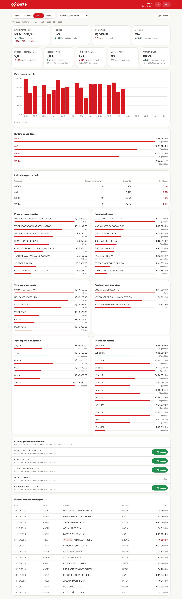
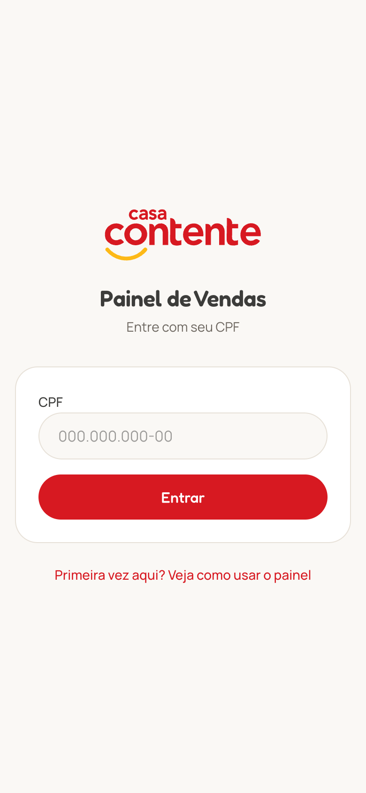
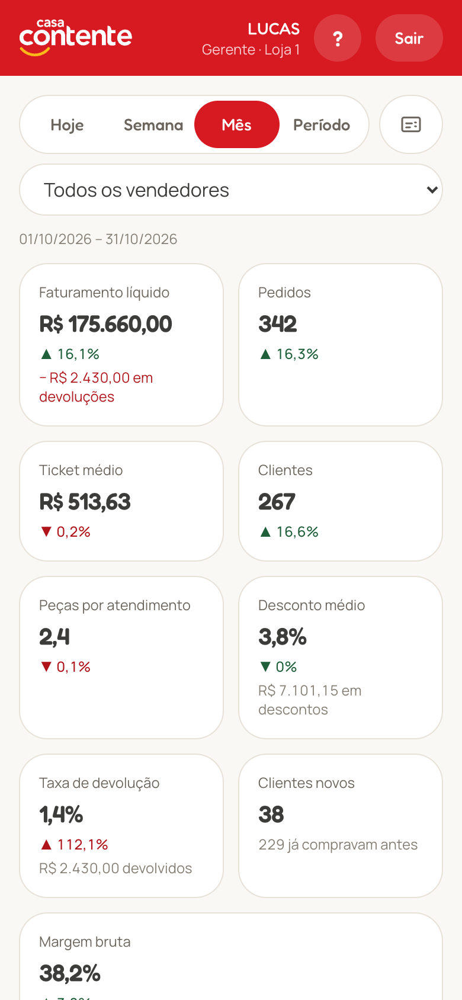
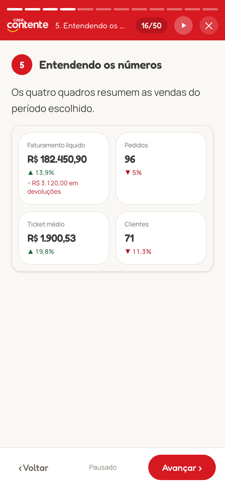

# Painel de Vendas (Sankhya)

Dashboard mobile-first para vendedores e gerentes acompanharem suas vendas.
Os dados vêm direto do Sankhya via API; nada é armazenado.

**Stack:** Next.js 16 (App Router, Server Components/Actions) · TypeScript · Tailwind 4 · Recharts.

## Telas

Capturas do sistema rodando com dados fictícios (nomes, valores e telefone inventados).



| Entrada com CPF | Painel no celular | Guia de uso (`/ajuda`) |
|:---:|:---:|:---:|
|  |  |  |

| Cartão de visita: QR code | Cartão de visita: nome e telefone |
|:---:|:---:|
|  |  |

## Rodando

```bash
cp .env.example .env      # preencha SANKHYA_CLIENT_ID/SECRET, SANKHYA_X_TOKEN e SESSION_SECRET (openssl rand -base64 48)
npm install
npm run dev               # desenvolvimento
npm run build && npm start   # produção (porta 3000)
```

Em produção, sirva **somente via HTTPS** (Nginx/Caddy/load balancer na frente).

## Como funciona

Toda a comunicação usa a **API oficial do Sankhya** (`api.sankhya.com.br`, OAuth 2.0
`client_credentials`) — o app não acessa o servidor Sankhya diretamente.

1. O usuário entra **apenas com o CPF**.
2. O sistema busca, com o usuário de integração:
   - `TFPFUN` pelo CPF, só funcionário ativo (`SITUACAO <> 0`) e não demitido (`DTDEM IS NULL`) → `CODEMP` + `CODFUNC` (a empresa entra no filtro porque o mesmo
     `CODFUNC` pode existir em empresas diferentes);
   - **gerente**: registro ativo em `TGFVEN` com esse `CODFUNC` + `CODEMP` e `TIPVEND` `S` ou `G`
     → vê a loja `TGFVEN.CODEMP`; gerente em mais de uma loja → acesso negado;
   - senão, **vendedor**: `TSIUSU` pelo par `CODEMP` + `CODFUNC` → `TSIUSU.CODVEND`; sem vendedor,
     vendedor inativo ou mais de um vendedor ativo → acesso negado.
3. Cria uma sessão em cookie criptografado (JWE A256GCM, `HttpOnly`, `Secure`, `SameSite=Lax`, 8h).
4. O dashboard consulta via `DbExplorerSP.executeQuery` pelo gateway
   (`/gateway/v1/mge/service.sbr`) com o token do usuário de integração. O SQL é montado
   **apenas no servidor** (SQL Server).

> ⚠️ Não há senha: quem souber o CPF de um vendedor acessa o painel dele. O limite de
> tentativas por IP dificulta varrer CPFs, mas não substitui uma senha.

### Regras de acesso (aplicadas no SQL, a partir da sessão criptografada)

| Perfil | Vê |
|---|---|
| Vendedor | apenas `TGFCAB.CODVEND = seu código`. Parâmetros na URL são ignorados. |
| Gerente | as vendas da sua loja: `TGFCAB.CODEMP` = empresa do gerente em `TGFVEN`. O filtro lista os vendedores ativos da loja e da equipe (`CODGER`). |

O filtro de vendedor do gerente só **restringe** (é somado com `AND`), nunca amplia.

### API oficial e usuário de integração (obrigatórios)

1. Na Área do Desenvolvedor Sankhya, cadastre a aplicação → `SANKHYA_CLIENT_ID` e `SANKHYA_CLIENT_SECRET`.
2. No Sankhya, tela **Configurações Gateway**, gere o token (`SANKHYA_X_TOKEN`) vinculado a um
   usuário de integração com acesso ao DbExplorer e leitura de `TFPFUN`, `TSIUSU`, `TGFVEN`,
   `TGFCAB`, `TGFITE` etc.

Todas as consultas rodam com esse usuário; vendedores e gerentes não precisam de acesso ao
DbExplorer, e o filtro de escopo acima é aplicado em todas as consultas. O token OAuth é
reaproveitado e renovado automaticamente antes de expirar.

## Guia de uso

A página `/ajuda` (pública, com link na tela de login e no `?` do cabeçalho) explica o painel passo a passo
para quem não é da área de tecnologia, com capturas de tela feitas com dados de exemplo (`public/ajuda/`).
O conteúdo é dividido em telas curtas no formato de stories (`src/app/ajuda/stories.tsx`): passam sozinhas no
tempo de leitura, com uma barrinha de progresso por seção no topo; segurar a tela ou o botão de pausa param.

## Instalar no celular (PWA)

O painel pode ser instalado como app (requer HTTPS):

- **Android (Chrome):** menu ⋮ → **Instalar app** (ou o aviso que aparece na barra).
- **iPhone (Safari):** Compartilhar → **Adicionar à Tela de Início**.

O app abre direto no dashboard, em tela cheia. O service worker (`public/sw.js`) **não guarda
dados de vendas em cache**: sem internet, mostra apenas a página `offline.html`.

## Cartão de visita (WhatsApp)

O botão **Cartão**, ao lado dos filtros, abre o cartão de visita do usuário logado: na frente,
nome (primeiro e último, de `TFPFUN.NOMEFUNC`), cargo e celular; tocando, ele vira e mostra um
QR code que abre o WhatsApp do vendedor (`https://wa.me/55<DDD><número>`).

O telefone vem de `TFPFUN.TELEFONE` (o funcionário que entrou, por `CODEMP` + `CODFUNC`) e
precisa ter DDD. Sem telefone válido, o cartão avisa e o log registra o usuário.

## Vendas e devoluções

`TGFCAB` com `SERIENOTA IS NOT NULL AND SERIENOTA > 0`, pela data `DTNEG`:

- `CODTIPOPER IN (SALES_TOPS_VENDA)` (padrão `1110, 1101, 1105, 1112, 1181`) → soma `VLRNOTA`;
- `CODTIPOPER IN (SALES_TOPS_DEVOLUCAO)` (padrão `1201`) → **subtrai** `VLRNOTA`, na data da devolução
  e para o vendedor da nota de devolução.

Faturamento, gráfico diário e rankings são **líquidos** (vendas − devoluções); produtos usam
`VLRTOT − VLRDESC` dos itens com o mesmo sinal. Devoluções aparecem em vermelho/negativo nas
últimas movimentações e o card de faturamento mostra o total devolvido. "Pedidos", "Clientes"
e o ticket médio (líquido ÷ pedidos) contam só as vendas.

## Indicadores complementares

Ficam em `src/lib/insights.ts`, com o mesmo escopo de acesso das vendas. Cada um roda numa consulta
própria: se falhar (ex.: coluna ausente nesta base do Sankhya), só aquele bloco some e o erro vai para o
log com o prefixo `[indicadores]`.

| Indicador | Como é calculado |
|---|---|
| Peças por atendimento | `SUM(TGFITE.QTDNEG)` ÷ notas de venda |
| Desconto médio | `SUM(TGFITE.VLRDESC)` ÷ `SUM(TGFITE.VLRTOT)` das vendas (desconto lançado nos itens) |
| Taxa de devolução | devoluções ÷ (faturamento líquido + devoluções), pelo `VLRNOTA` |
| Clientes novos | clientes do período cuja primeira venda (em qualquer loja) foi dentro do período |
| Vendas por categoria | itens agrupados por `TGFPRO.CODGRUPOPROD` → `TGFGRU.DESCRGRUPOPROD`, líquidos de devolução |
| Produtos mais devolvidos | itens das notas de devolução, por produto |
| Dia da semana / horário | `TGFCAB.DTNEG` e `TGFCAB.HRMOV` (aceita HHMM ou HHMMSS); dia da semana só com período ≥ 7 dias |
| Clientes para chamar de volta | 3+ vendas nos últimos 365 dias e nenhuma há mais de 60 dias (`CODPARC > 0`), com WhatsApp por `TGFPAR.TELEFONE`; não depende do período escolhido |
| Indicadores por vendedor (gerente) | peças por atendimento, desconto e devolução (pelos itens) de cada vendedor |
| Margem bruta (gerente) | (receita − custo) ÷ receita dos itens com custo; custo = registro mais recente de `TGFCUS` até a data da venda, na coluna `MARGEM_CUSTO` (padrão `CUSGER`). Avisa quando falta custo em mais de 5% da receita |

## Segurança

- Cookie de sessão criptografado; nada sensível exposto ao navegador.
- Proxy (`src/proxy.ts`) bloqueia tudo sem sessão; as páginas revalidam a sessão.
- Login com limite de 5 tentativas / 15 min por IP e por CPF; o CPF completo não vai para os logs (em memória — com várias
  instâncias, use limite no proxy reverso; o IP vem de `X-Forwarded-For`, então o proxy precisa sobrescrevê-lo).
- Server Actions com verificação de origem (CSRF), CSP, `X-Frame-Options: DENY`, HSTS, `no-store`.
- Valores no SQL passam por helpers que validam inteiros/datas e escapam textos (`src/lib/sankhya/sql.ts`).

## Estrutura

```
src/proxy.ts                 barreira de autenticação
src/app/actions.ts           login/logout (Server Actions)
src/app/dashboard/page.tsx   dashboard (Server Component)
src/lib/sankhya/client.ts    API oficial Sankhya (OAuth + gateway)
src/lib/sankhya/profile.ts   CPF → funcionário → usuário → vendedor/perfil
src/lib/sales.ts             consultas + regras de escopo
src/lib/period.ts            hoje / semana / mês / período (fuso America/Sao_Paulo)
```
