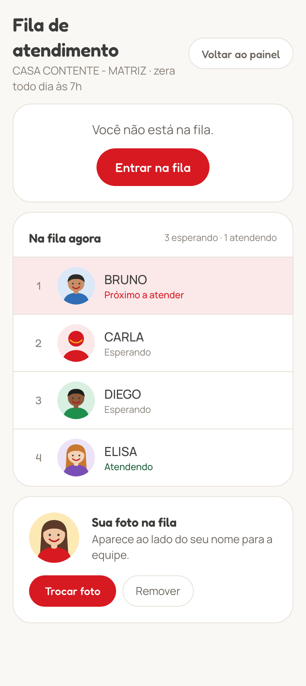
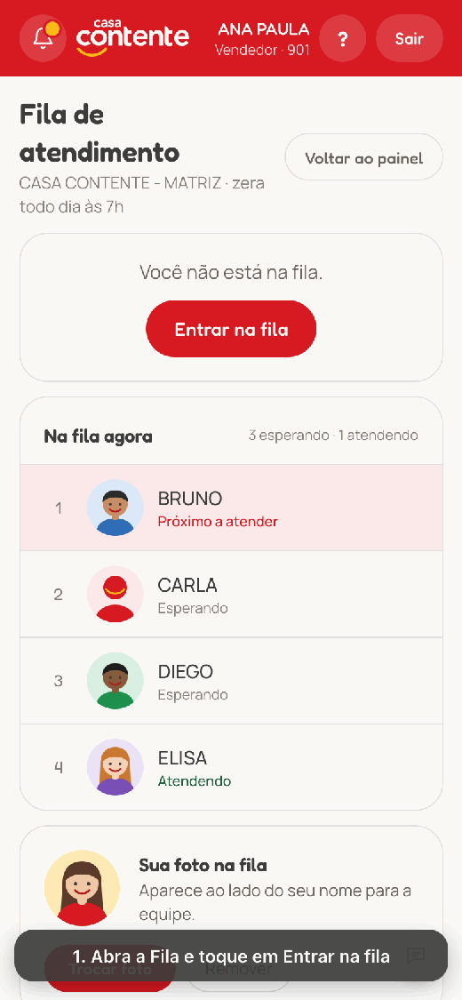
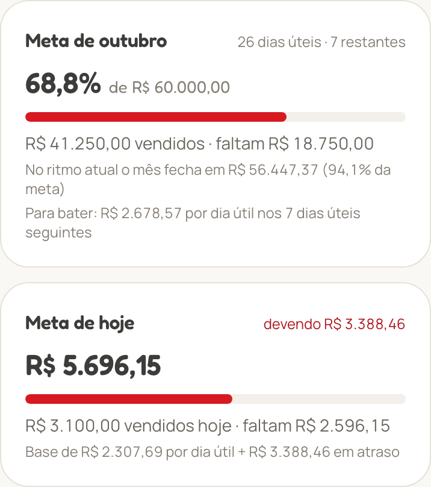
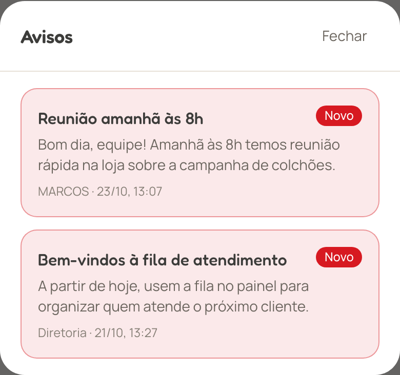
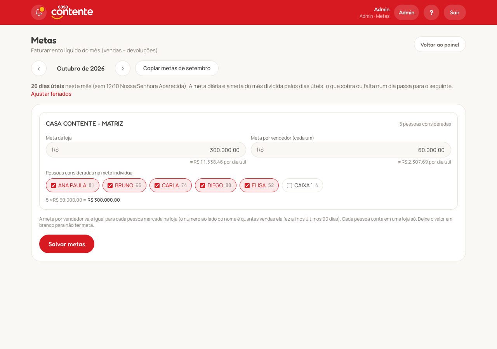
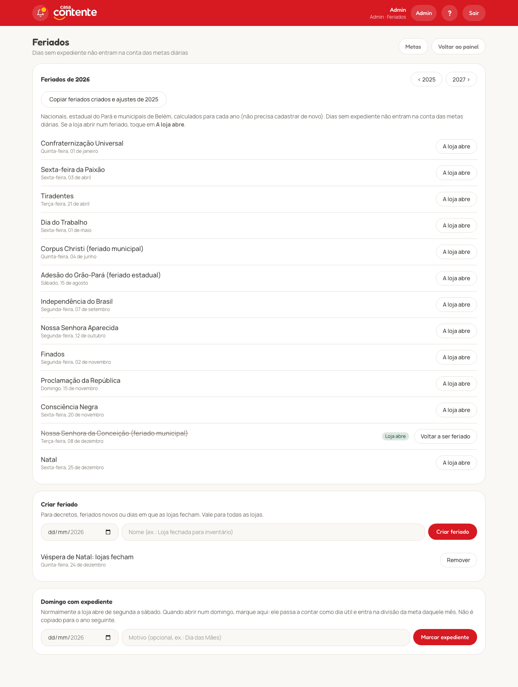
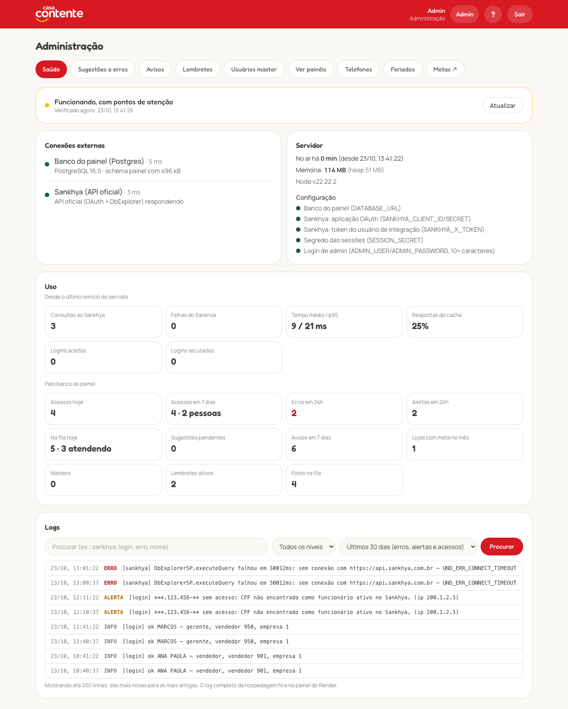
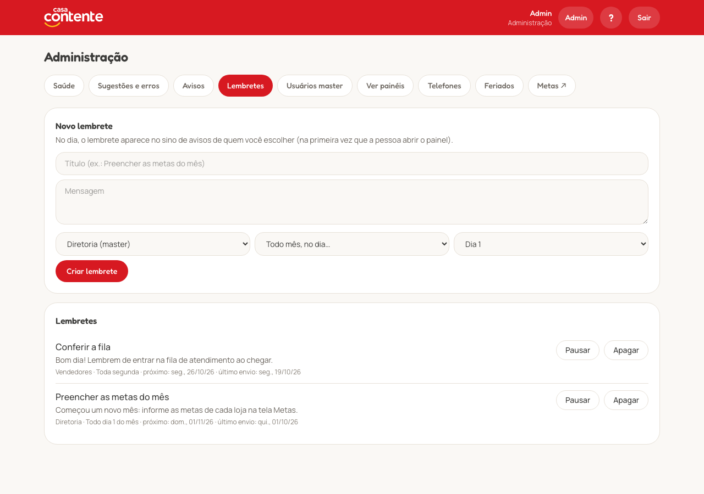

# Painel de Vendas (Sankhya)

Dashboard mobile-first para vendedores e gerentes acompanharem suas vendas.
Os dados de vendas vêm direto do Sankhya via API e não são armazenados. O que o Sankhya não tem
(fila de atendimento, metas, feriados, avisos, lembretes, sugestões, usuários master, telefones e fotos)
fica num Postgres (schema `painel`, ver abaixo).

**Stack:** Next.js 16 (App Router, Server Components/Actions) · TypeScript · Tailwind 4 · Recharts.

## Telas

Capturas do sistema rodando com dados fictícios (nomes, valores e telefone inventados).


| Entrada com CPF | Painel no celular | Guia de uso (`/ajuda`) |
|:---:|:---:|:---:|
|  |  |  |

| Cartão de visita: QR code | Cartão de visita: nome, telefone e foto |
|:---:|:---:|
|  |  |

### Fila de atendimento, metas e avisos (celular)

| Fila de atendimento (`/fila`) | Como a fila funciona | Meta do mês e meta de hoje | Sino de avisos |
|:---:|:---:|:---:|:---:|
|  |  |  |  |

### Diretoria e admin (computador)



| Feriados e dias úteis (`/feriados`) | Saúde do app (admin) |
|:---:|:---:|
|  |  |

| Lembretes (admin) |
|:---:|
|  |

## Testes

```bash
npm run typecheck                     # tipos
npm test                              # regras (Vitest): metas, dias úteis, lembretes, escopo de acesso, SQL, sessão, senha…
TEST_DATABASE_URL=postgres://… npm test    # + testes de banco: fila, atendimentos, metas, avisos e lembretes
npm run build && TEST_DATABASE_URL=postgres://… npm run test:e2e   # ponta a ponta (Playwright)
```

- `tests/unit`: funções puras (conta da meta em `src/lib/goal-math.ts`, feriados, ocorrências dos lembretes, escopo das
  consultas por papel, helpers de SQL, sessão criptografada, hash de senha, valores e telefones).
- `tests/db`: rodam só com `TEST_DATABASE_URL`, um **Postgres descartável**: criam o schema `painel` com `db/schema.sql`
  e limpam as tabelas a cada teste. Nunca aponte para o banco de produção.
- `tests/e2e`: o app compilado com um Sankhya simulado (`tests/e2e/fake-sankhya.mjs`) e o Postgres de teste: fila completa
  com o resultado do atendimento, login da diretoria com senha, permissões.
- **CI** (`.github/workflows/ci.yml`): roda tudo a cada push, com um Postgres de serviço do GitHub Actions.

## Rodando

```bash
cp .env.example .env      # preencha SANKHYA_CLIENT_ID/SECRET, SANKHYA_X_TOKEN, SESSION_SECRET (openssl rand -base64 48),
                          # DATABASE_URL, ADMIN_USER e ADMIN_PASSWORD
npm install
npm run dev               # desenvolvimento
npm run build && npm start   # produção (porta 3000)
```

Em produção, sirva **somente via HTTPS** (Nginx/Caddy/load balancer na frente).

## Como funciona

Toda a comunicação usa a **API oficial do Sankhya** (`api.sankhya.com.br`, OAuth 2.0
`client_credentials`) — o app não acessa o servidor Sankhya diretamente.

1. O usuário entra **com o CPF**. Se o CPF estiver em `painel.usuario_master`, é **master** (diretoria): em seguida
   informa a **senha**, criada por ele mesmo no primeiro acesso (pelo menos 8 caracteres, guardada só como hash scrypt
   em `senha_hash`; troca em **Minha senha**, `/senha`). O admin vê quem ainda não criou a senha e pode **zerar** a senha.
   Até o primeiro acesso, quem souber o CPF poderia criar a senha: peça aos diretores para entrarem logo.
2. Senão, o sistema busca, com o usuário de integração:
   - `TFPFUN` pelo CPF, só funcionário ativo (`SITUACAO <> 0`) e não demitido (`DTDEM IS NULL`) → `CODEMP` + `CODFUNC` (a empresa entra no filtro porque o mesmo
     `CODFUNC` pode existir em empresas diferentes);
   - **gerente**: registro ativo em `TGFVEN` com esse `CODFUNC` + `CODEMP` e `TIPVEND` `S` ou `G`
     → vê a loja `TGFVEN.CODEMP`; gerente em mais de uma loja → acesso negado;
   - senão, **vendedor**: `TSIUSU` pelo par `CODEMP` + `CODFUNC` → `TSIUSU.CODVEND`; sem vendedor,
     vendedor inativo ou mais de um vendedor ativo → acesso negado.
3. Cria uma sessão em cookie criptografado (JWE A256GCM, `HttpOnly`, `Secure`, `SameSite=Lax`, 8h).
4. O dashboard consulta via `DbExplorerSP.executeQuery` pelo gateway
   (`/gateway/v1/mge/service.sbr`) com o token do usuário de integração. O SQL é montado
   **apenas no servidor** (SQL Server).

> ⚠️ Não há senha: quem souber o CPF de um vendedor acessa o painel dele. O limite de
> tentativas por IP dificulta varrer CPFs, mas não substitui uma senha.

### Regras de acesso (aplicadas no SQL, a partir da sessão criptografada)

| Perfil | Vê |
|---|---|
| Vendedor | apenas `TGFCAB.CODVEND = seu código`. Parâmetros na URL são ignorados. |
| Gerente | as vendas da sua loja: `TGFCAB.CODEMP` = empresa do gerente em `TGFVEN`. O filtro lista só os vendedores da mesma loja (`TGFVEN.CODEMP`) com venda ou devolução no período. |
| Master (diretoria) | todas as lojas, com ranking de lojas; pode escolher uma loja (`?loja=`) e um vendedor dela. CPFs cadastrados pelo admin. |
| Admin | tudo o que o master vê, a área `/admin` e o painel de qualquer master, gerente ou vendedor, escolhido pelo nome (com filtro por tipo de acesso). |

Os parâmetros `loja` e `vendedor` da URL só valem para quem tem esse acesso; o vendedor continua preso ao próprio `CODVEND`.
Quando o admin escolhe uma pessoa, a sessão guarda essa pessoa (relida do `TGFVEN` pelo código, ou de `painel.usuario_master` no caso do master) e o painel usa exatamente as
regras dela; uma faixa amarela mostra de quem é o painel e o botão **Voltar ao admin**.

O filtro de vendedor do gerente só **restringe** (é somado com `AND`), nunca amplia.

### API oficial e usuário de integração (obrigatórios)

1. Na Área do Desenvolvedor Sankhya, cadastre a aplicação → `SANKHYA_CLIENT_ID` e `SANKHYA_CLIENT_SECRET`.
2. No Sankhya, tela **Configurações Gateway**, gere o token (`SANKHYA_X_TOKEN`) vinculado a um
   usuário de integração com acesso ao DbExplorer e leitura de `TFPFUN`, `TSIUSU`, `TGFVEN`,
   `TGFCAB`, `TGFITE` etc.

Todas as consultas rodam com esse usuário; vendedores e gerentes não precisam de acesso ao
DbExplorer, e o filtro de escopo acima é aplicado em todas as consultas. O token OAuth é
reaproveitado e renovado automaticamente antes de expirar.

## Guia de uso

A página `/ajuda` (pública, com link na tela de login e no `?` do cabeçalho) explica o painel passo a passo
para quem não é da área de tecnologia, com capturas de tela feitas com dados de exemplo (`public/ajuda/`).
O conteúdo é dividido em telas curtas no formato de stories (`src/app/ajuda/stories.tsx`): passam sozinhas no
tempo de leitura, com uma barrinha de progresso por seção no topo; segurar a tela ou o botão de pausa param.

## Instalar no celular (PWA)

O painel pode ser instalado como app (requer HTTPS):

- **Android (Chrome):** menu ⋮ → **Instalar app** (ou o aviso que aparece na barra).
- **iPhone (Safari):** Compartilhar → **Adicionar à Tela de Início**.

O app abre direto no dashboard, em tela cheia. O service worker (`public/sw.js`) guarda **a última
versão do painel que carregou com dados** (cache `dv-dados`) e os arquivos JS/CSS do Next. Sem internet, abre essa
cópia com um aviso amarelo dizendo de quando são os dados; sem cópia, mostra `offline.html`. A cópia é apagada ao
abrir a tela de login (sair, sessão expirada) e quando o servidor redireciona para o login. Telas de erro não
substituem a última cópia boa (a página marca o painel carregado com `data-offline-ok`).

## Cartão de visita (WhatsApp)

O botão **Cartão**, ao lado dos filtros, abre o cartão de visita do usuário logado: primeiro o
QR code que abre o WhatsApp do vendedor (`https://wa.me/55<DDD><número>`); tocando, ele vira e mostra
nome (primeiro e último, de `TFPFUN.NOMEFUNC`), cargo, celular e, se o vendedor enviou, a mesma foto
da fila de atendimento.

O telefone vem de `painel.telefone` (salvo pelo app) ou, sem ele, de `TFPFUN.TELEFONE` (o funcionário
que entrou, por `CODEMP` + `CODFUNC`), e precisa ter DDD. Sem telefone válido, o cartão avisa e o log registra o usuário.

**Atualizar telefone** (botão embaixo do cartão) salva o novo número no app, pelo código do vendedor, e o QR code passa
a usá-lo; **Usar o do Sankhya** apaga o salvo. O gerente edita os da equipe da loja (`TGFVEN.CODEMP`) em
**Telefones da equipe**, no painel; o admin edita os de todos na aba **Telefones**. Master não tem cartão.

## Vendas e devoluções

`TGFCAB` com série numérica maior que zero (`SERIENOTA` é texto e há séries como `CF`, de cupom, que ficam
de fora; a checagem não converte o texto, então não quebra a consulta), pela data `DTNEG`:

- `CODTIPOPER IN (SALES_TOPS_VENDA)` (padrão `1110, 1101, 1105, 1112, 1181`) → soma `VLRNOTA`;
- `CODTIPOPER IN (SALES_TOPS_DEVOLUCAO)` (padrão `1201`) → **subtrai** `VLRNOTA`, na data da devolução
  e para o vendedor da nota de devolução.

Faturamento, gráfico diário e rankings são **líquidos** (vendas − devoluções); produtos usam
`VLRTOT − VLRDESC` dos itens com o mesmo sinal. Devoluções aparecem em vermelho/negativo nas
últimas movimentações e o card de faturamento mostra o total devolvido. "Pedidos", "Clientes"
e o ticket médio (líquido ÷ pedidos) contam só as vendas.

Rankings, a tabela de indicadores por vendedor e os filtros de vendedor só listam vendedores ativos
(`TGFVEN.ATIVO = 'S'`). As vendas de quem foi desativado continuam somando nos totais da loja.

## Desempenho

- As consultas do painel saem todas ao mesmo tempo (vendas, avisos, lojas e indicadores).
- O topo (filtros, faturamento, pedidos, gráfico) aparece assim que as vendas chegam; cada indicador
  complementar aparece sozinho quando a consulta dele termina (Suspense), sem segurar a tela.
- Cache curto em memória no cliente do Sankhya (`src/lib/sankhya/client.ts`): resultados valem 1 minuto
  (lojas 10 min, lista de pessoas 5 min); consultas iguais ao mesmo tempo viram uma só. A chave é o SQL inteiro,
  que já traz o escopo de quem pediu. Login e checagens de permissão sempre consultam na hora.

## Indicadores complementares

Ficam em `src/lib/insights.ts`, com o mesmo escopo de acesso das vendas. Cada um roda numa consulta
própria: se falhar (ex.: coluna ausente nesta base do Sankhya), só aquele bloco some e o erro vai para o
log com o prefixo `[indicadores]`.

| Indicador | Como é calculado |
|---|---|
| Peças por atendimento | `SUM(TGFITE.QTDNEG)` ÷ notas de venda |
| Desconto médio | `SUM(TGFITE.VLRDESC)` ÷ `SUM(TGFITE.VLRTOT)` das vendas (desconto lançado nos itens) |
| Taxa de devolução | devoluções ÷ (faturamento líquido + devoluções), pelo `VLRNOTA` |
| Clientes novos | clientes do período cuja primeira venda (em qualquer loja) foi dentro do período |
| Vendas por categoria | itens agrupados por `TGFPRO.CODGRUPOPROD` → `TGFGRU.DESCRGRUPOPROD`, líquidos de devolução |
| Produtos mais devolvidos | itens das notas de devolução, por produto |
| Dia da semana / horário | `TGFCAB.DTNEG` e `TGFCAB.HRMOV` (aceita HHMM ou HHMMSS); dia da semana só com período ≥ 7 dias |
| Clientes para chamar de volta | 2+ vendas nos últimos 365 dias e nenhuma há mais de 60 dias (`CODPARC > 0`), com WhatsApp por `TGFPAR.TELEFONE`; não depende do período escolhido; até 100, 10 por página. O **×** tira o cliente da lista (`painel.cliente_dispensado`) para todos até ele comprar de novo |
| Indicadores por vendedor (gerente) | peças por atendimento, desconto e devolução (pelos itens) de cada vendedor |
| Margem bruta (gerente) | (receita − custo) ÷ receita dos itens com custo; custo = registro mais recente de `TGFCUS` até a data da venda, na coluna `MARGEM_CUSTO` (padrão `CUSGER`). Avisa quando falta custo em mais de 5% da receita |

## Metas (`/metas`) e feriados (`/feriados`)

Master e admin informam, numa tela só com as lojas que vendem (as de `META_LOJAS_FORA` ficam de fora; padrão 2, 7 e 100 —
Dr. Freitas, Ananindeua e Ultralog), **dois valores por loja**: a **meta da loja** e a
**meta por vendedor** (a mesma para cada pessoa considerada). Em cada loja marcam as **pessoas consideradas**: as
candidatas são quem vendeu ali nos últimos 90 dias (o cadastro de vendedores do Sankhya tem caixas e códigos internos, e
há quem venda em mais de uma loja); cada pessoa conta em uma loja só. A meta individual de uma pessoa é medida pelas vendas
dela **na loja em que foi considerada**. Botão para **copiar as metas e as pessoas do mês anterior**, sem sobrescrever
o que já foi preenchido. Tabelas `painel.meta` (`codvend` 0 = loja, -1 = por vendedor) e `painel.meta_pessoa`.

**Metas diárias** (`src/lib/goal-progress.ts`):

- meta diária base = meta do mês ÷ dias úteis do mês;
- saldo = vendido até ontem − base × dias úteis que já passaram (positivo = sobra, negativo = devendo);
- folga, férias e atestado não mudam a conta: o dia continua valendo e quem não vendeu fica devendo (folgou um dia,
  no seguinte a meta é de dois dias);
- meta de hoje = base − saldo (nunca abaixo de zero): vender mais deixa a meta do dia seguinte menor; vender menos,
  maior;
- projeção = vendido ÷ dias úteis decorridos × dias úteis do mês.

No painel aparecem **Meta do mês** e **Meta de hoje** (do vendedor, da loja para o gerente ou da loja/todas para
master e admin; com filtro de vendedor, a meta dele) e a lista **Metas da equipe** (as pessoas consideradas) ou
**Metas por loja**.
Valem sempre para o mês atual, qualquer que seja o período escolhido.

**Para a diretoria (master e admin, todas as lojas):** quanto falta por dia útil para bater a meta, se cada loja
**fecha o mês** no ritmo atual ("no ritmo" / "abaixo do ritmo", com a projeção e o ritmo necessário), a lista
**Metas por vendedor (todas as lojas)** e o card **Crescimento vs ano anterior** (faturamento líquido do período
comparado com as mesmas datas do ano passado, cortado na data de hoje). O master não vê "Clientes para chamar de
volta" (a consulta nem roda).

**Dias úteis** (`src/lib/workdays.ts`): dias da semana em `META_DIAS_SEMANA` (padrão segunda a sábado), menos os
feriados de Belém do Pará, calculados para qualquer ano (Páscoa pelo algoritmo de Meeus):

| Tipo | Datas |
|---|---|
| Nacionais | 1/1, Sexta-feira da Paixão, 21/4, 1/5, 7/9, 12/10, 2/11, 15/11, 20/11, 25/12 |
| Estadual (PA) | 15/8, Adesão do Grão-Pará |
| Municipais (Belém) | Corpus Christi, 8/12 Nossa Senhora da Conceição |

Pontos facultativos (Carnaval, 12/1, segunda do Círio, Recírio) não entram. Na tela **Feriados** (master e admin; também
na aba do admin) dá para **criar feriados** (decretos, loja fechada), marcar que **a loja abre** num feriado do
calendário, marcar um **domingo com expediente** (conta como dia útil naquele mês; não é copiado) e **copiar os ajustes do
ano anterior** — feriados móveis acompanham a data nova. Ajustes em `painel.feriado`.

## Saúde do app (admin)

Aba **Saúde** do admin, medida na hora em que abre:

- **Status geral** (verde / atenção / problema) a partir das verificações abaixo.
- **Conexões externas:** Postgres (`SELECT` no schema `painel`) e Sankhya (OAuth + uma consulta mínima, sem cache), com
  o tempo de cada um e o último erro do Sankhya.
- **Servidor:** há quanto tempo está no ar, memória, versão (`RENDER_GIT_COMMIT`) e quais variáveis de ambiente faltam
  (sem mostrar valores).
- **Uso:** desde o último reinício (consultas ao Sankhya, falhas, tempo médio e p95, % de respostas do cache, logins
  aceitos e recusados) e pelo banco (acessos hoje e em 7 dias, erros e alertas em 24h, fila de hoje, sugestões
  pendentes, avisos, lojas com meta, masters, lembretes, fotos).
- **Logs com busca** por texto e nível: últimos 30 dias de erros, alertas e acessos (`painel.evento`) ou tudo desde o
  último reinício (memória, últimas 2.000 linhas).

O `src/instrumentation.ts` liga o monitor (`src/lib/monitor*.ts`): copia o console do servidor para a memória, grava
erros, alertas e linhas `[login]`/`[admin]` no banco em lotes a cada 5 s (apagando o que passa de 30 dias) e registra os
erros de página do Next (`onRequestError`). O log completo da hospedagem continua no Render.

## Notificações no celular (Web Push)

O vendedor ativa em **Notificações no celular** (aviso no painel e quadro na tela da fila); o celular pede permissão e
a inscrição vai para `painel.push_inscricao`. As chaves VAPID são geradas na primeira vez e ficam em `painel.config`
(nada a configurar na hospedagem; `PUSH_SUBJECT` opcional). O service worker mostra a notificação e, ao tocar, abre a
tela certa.

| Quando | Para quem |
|---|---|
| Alguém vira o **próximo da fila** | Só esse vendedor ("🙋 É a sua vez!", prioridade alta, válida por 10 min); quem fez a ação não recebe |
| **Aviso** enviado | Os mesmos do sino: a loja (vendedores e gerentes) ou todos |
| **Lembrete** entregue | O público do lembrete |

Inscrições que o serviço de push devolve como inexistentes (404/410) são apagadas. **iPhone:** só com o painel
instalado na tela inicial (iOS 16.4+). A aba Saúde mostra quantos celulares estão inscritos.

## Lembretes (admin)

Aba **Lembretes** do admin: título, mensagem, público (diretoria, gerentes, vendedores ou todos) e repetição — todo mês
num dia (no mês mais curto, o último dia), toda semana num dia, todo dia ou uma data só. No dia, o lembrete vira um
aviso no **sino** do público escolhido (`painel.aviso.papel`), na primeira abertura de tela depois de vencer (não há
tarefa agendada; um `UPDATE` condicional em `painel.lembrete.ultimo_envio` garante uma entrega por ocorrência).
Ocorrências de antes da criação do lembrete não são entregues. Dá para pausar e apagar. Não há notificação no celular
com o app fechado.

## Fila de atendimento (`/fila`)

Botão **Fila** ao lado dos filtros do painel. Uma fila por loja por dia, em `painel.fila`.

- **Zera às 7h:** o "dia" da fila vira às 7h de Brasília (`now() - 7h`), então às 7h ela começa vazia sem tarefa
  agendada; filas com mais de 7 dias são apagadas aos poucos.
- **Só a própria loja:** a loja do vendedor é `TGFVEN.CODEMP` do seu código (a mesma regra da equipe do gerente),
  sempre tirada da sessão; o vendedor não consegue ver nem entrar na fila de outra loja.
- **Vendedor:** *Entrar na fila* → espera; o primeiro que está esperando aparece como **Próximo a atender**.
  *Atender cliente* marca como atendendo e manda para o **fim da fila**; *Terminei o atendimento* volta a esperar
  nessa posição. *Sair da fila* tira.
- **Gerente da loja:** vê só a fila da loja dele (sem seletor), muda a ordem (↑ ↓) e tira alguém (×). O master escolhe a
  loja; o **admin** vê **todas as filas de uma vez** (só as lojas que vendem: as de `META_LOJAS_FORA` ficam de fora) (cada uma editável e atualizando sozinha) ou uma loja escolhida. O admin
  vendo o painel de um gerente ou vendedor vê a fila da loja dessa pessoa, com os controles de gerente.
- **Resultado do atendimento:** "Atender cliente" abre um registro em `painel.atendimento`; "Terminei o atendimento" pergunta
  **Vendeu / Não vendeu / Só olhando** e, se não vendeu, o motivo (preço, não tinha o produto, vai voltar, outro). Sair da
  fila ou ser tirado no meio fecha o atendimento sem resultado. No painel, **Atendimentos da fila** (no período escolhido):
  atendimentos, **conversão** (vendeu ÷ atendimentos com resultado), tempo médio e notas emitidas no Sankhya, por vendedor
  (gerente) ou por loja (diretoria), e os **motivos de perda**. O vendedor vê os dele.
- **Atualização:** a tela busca `/api/fila` a cada 4 s (só com a tela visível) e na hora depois de cada ação.
- **Foto:** o vendedor envia a própria foto; o navegador recorta e reduz para JPEG 256×256 antes de enviar. O servidor
  confere que é JPEG (pelo conteúdo) e aceita até 300 KB. Fica em `painel.foto`, **uma por vendedor**: a nova substitui
  a anterior. Servida em `/api/foto/<codvend>` só para quem está logado.

## Avisos, sugestões e admin

Ficam no Postgres `loja-casacontente-db` (o mesmo da nova loja, para não criar mais um banco), no schema
**`painel`**, separado das tabelas da loja (`site`, `erp`). As tabelas estão em `db/schema.sql`
(pode rodar de novo sem problema). No Render, `DATABASE_URL` usa a URL interna. Se o banco cair, o painel de vendas
continua funcionando; só o sino some e o envio de sugestões avisa o erro.

| Tabela | Para quê |
|---|---|
| `usuario_master` | CPFs da diretoria (veem todas as lojas). Removido aqui, perde o acesso no próximo carregamento. |
| `aviso` | Avisos do sino; `codemp` nulo = todas as lojas |
| `aviso_visto` | Última vez que cada usuário abriu o sino (marca os novos) |
| `feedback` | Sugestões e erros, com status concluído |
| `telefone` | Telefone do cartão salvo pelo app, por `CODVEND`; tem prioridade sobre o do Sankhya |
| `meta` | Metas mensais por loja: `codvend` 0 = meta da loja, -1 = meta por vendedor |
| `meta_pessoa` | Pessoas consideradas na meta individual de cada loja no mês (uma loja por pessoa) |
| `feriado` | Feriados criados e dias em que a loja abre num feriado (ajustes do calendário) |
| `evento` | Erros, alertas e acessos para a tela Saúde (30 dias) |
| `push_inscricao` | Celulares inscritos para notificações (um por navegador/aparelho) |
| `config` | Configurações geradas pelo app (chaves VAPID) |
| `lembrete` | Lembretes recorrentes do admin (viram avisos no sino) |
| `atendimento` | Atendimentos da fila: início, fim, resultado (vendeu / não vendeu / só olhando) e motivo |
| `fila` | Fila de atendimento por loja e dia (zera às 7h) |
| `foto` | Foto do vendedor na fila (uma por vendedor, JPEG 256×256) |
| `cliente_dispensado` | Clientes tirados de "Clientes para chamar de volta" (ex.: não querem voltar); reaparecem se comprarem depois |

- **Sino** (canto superior esquerdo): bolinha amarela quando há aviso novo. Vendedor e gerente veem os avisos de todas as
  lojas e os da sua loja; o **gerente** envia para a própria loja; **master** e **admin** veem todos e enviam para uma loja
  ou para todas.
- **Sugestões e erros**: botão flutuante discreto no canto inferior direito (abre o texto ao passar o mouse). Guarda a página e o navegador para ajudar a reproduzir.
- **Admin** (`/admin`: sem sessão de admin, o próprio endereço mostra o login com usuário e senha em `ADMIN_USER`/`ADMIN_PASSWORD`; sem os dois o acesso fica desligado):
  sugestões e erros (concluir/reabrir e **Criar issue no GitHub**, que abre o formulário de issue já preenchido em
  `GITHUB_REPO` — o repositório é público, então vai só a mensagem, sem o nome de quem enviou), avisos (enviar e apagar),
  usuários master, **Telefones** e **Ver painéis** (busca por nome, com filtro Master / Gerente / Vendedor).

## Segurança

- Cookie de sessão criptografado; nada sensível exposto ao navegador.
- Proxy (`src/proxy.ts`) bloqueia tudo sem sessão; as páginas revalidam a sessão.
- Login de admin com usuário e senha comparados em tempo constante e o mesmo limite de tentativas por IP.
- Server Actions de avisos, sugestões e admin conferem sessão e papel no servidor; o SQL do Postgres é sempre parametrizado.
- Login com limite de 5 tentativas / 15 min por IP e por CPF; o CPF completo não vai para os logs (em memória — com várias
  instâncias, use limite no proxy reverso; o IP vem de `X-Forwarded-For`, então o proxy precisa sobrescrevê-lo).
- Server Actions com verificação de origem (CSRF), CSP, `X-Frame-Options: DENY`, HSTS, `no-store`.
- Valores no SQL passam por helpers que validam inteiros/datas e escapam textos (`src/lib/sankhya/sql.ts`).

## Estrutura

```
src/proxy.ts                 barreira de autenticação
src/app/actions.ts           login/logout (Server Actions)
src/app/dashboard/page.tsx   dashboard (Server Component)
src/lib/sankhya/client.ts    API oficial Sankhya (OAuth + gateway)
src/lib/sankhya/profile.ts   CPF → funcionário → usuário → vendedor/perfil
src/lib/sales.ts             consultas + regras de escopo
src/lib/period.ts            hoje / semana / mês / período (fuso America/Sao_Paulo)
src/lib/db.ts                Postgres do painel (pool pequeno)
src/lib/painel.ts            masters, avisos e sugestões
src/app/painel-actions.ts    enviar aviso / sugestão (Server Actions)
src/app/admin/               área de admin (login, abas, ações)
src/app/fila/                fila de atendimento (tela, ações, foto)
src/app/metas/, feriados/    metas mensais e ajustes de feriado (master e admin)
src/lib/goal-progress.ts     meta do mês, meta de hoje, saldo e projeção
src/lib/workdays.ts          dias úteis e feriados de Belém
src/lib/fila.ts              fila e fotos no Postgres
db/schema.sql                tabelas do schema painel
```
